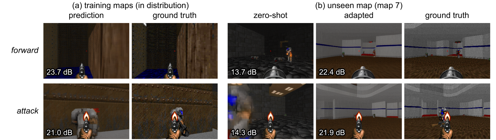

# DoomShift: How Much Adaptation Do World Models Need Under Domain Shift?

**Rohan Nagabhirava, Keerthana Chirumamilla, Changliu Liu** · Carnegie Mellon University

CoRL 2026 Workshops: Bringing Physics Simulation and World Models Together for Robotic Manipulation (PhysWM) and The Action Gap (TAG)

[Project page](https://intelligent-control-lab.github.io/DoomShift/) ·
[Paper](https://intelligent-control-lab.github.io/DoomShift/static/DoomShift.pdf) ·
[Dataset](https://huggingface.co/datasets/RohanNaga/doom-dense-arnold) ·
[Latents](https://huggingface.co/datasets/RohanNaga/doom-dense-arnold-latents) ·
[Models](https://huggingface.co/RohanNaga/doomdit-nexttic)



DoomShift isolates a scene shift: 17 Doom maps share one physics and game engine and differ only in layout, textures and lighting. Three diffusion world models (SD 1.4 U-Net, PixArt-α, SD 3.5 Medium) are trained on 4 maps and tested on 13 maps they never saw. On the unseen maps all three keep responding to the turn control, but scene PSNR drops 2.8–3.3 dB and LPIPS roughly doubles. Rank-16 LoRA adapters trained on 8 episodes of a new map, with 2% of the pretraining updates, recover 72–76% of the LPIPS rise and about half of the lost PSNR.

## Contents

| Stage | Script | What it does |
|---|---|---|
| Data | `record_arnold.py` | Records ViZDoom deathmatch episodes played by the Arnold agent: every tic, a 320×240 frame and the executed buttons, into per-episode parquet files |
| | `encode_parquet.py` | Encodes the frames to latents with the backbone's autoencoder (SD KL-f8, 4 channels; SD 3.5, 16 channels) |
| | `make_dense_eval_splits.py`, `adapt_split.py` | Builds the held-out evaluation splits and the per-map adaptation splits |
| Models | `backbones.py`, `diffusion_v.py`, `lora.py` | The three backbones behind one interface, the v-prediction objective with context-noise augmentation, and the LoRA adapters |
| Training | `train_wm.py` | Trains a next-tic world model on any backbone under one recipe: 32 context frames and the newest action |
| Decoder | `finetune_decoder.py` | Fine-tunes the VAE decoder on training-map frames (MSE + 0.1 LPIPS), encoder frozen |
| Adaptation | `adapt_wm.py` | Adapts a trained model to an unseen map with rank-16 LoRA on the attention layers (or a full fine-tune) |
| Evaluation | `eval_tf.py` | Scene PSNR and LPIPS one tic ahead against the raw frame |
| | `directional_check.py` | The turn-response score: flip the last turn and count the windows whose predicted horizontal shift reverses direction |
| | `score_adapt.py` | Scores every checkpoint of an adaptation run and computes the recovered shares |
| | `rollout_eval.py` | Closed-loop rollouts |
| Support | `doom_data.py`, `transitions.py`, `eval_metrics.py`, `eval_identity.py`, `decoder_provenance.py`, `periodic_eval.py`, `wandb_log.py`, `timestep_spacing.py`, `doomdit_utils.py`, `check_*.py`, `verify_*.py` | Datasets and splits, metrics, provenance checks, logging and pre-launch checks |

`release/dense_split.json` fixes the episode ranges of the training, validation and held-out sets, and `release/decoder_registry.json` records what each decoder was tuned on. `models.py` and `diffusion/` come from [DiT](https://github.com/facebookresearch/DiT) (see Licensing). The Wan and UniDiffuser code paths (`encode_wan.py`, `wan_data.py`, `verify_wan.py`, `train_idm.py`) support backbones explored during the project but not reported in the paper.

## Setup

Python 3.10 or 3.11 with a CUDA GPU (the paper's runs used RTX A6000 and A4000 cards).

```bash
git clone https://github.com/intelligent-control-lab/DoomShift.git
cd DoomShift
python -m venv .venv && source .venv/bin/activate
pip install -r requirements.txt
```

Recording new episodes additionally needs [ViZDoom](https://github.com/Farama-Foundation/ViZDoom) and the [Arnold](https://github.com/glample/Arnold) agent with `third_party/arnold-torch2.patch` applied (it ports Arnold to current PyTorch).

## Data and checkpoints

Everything in the paper is on the Hugging Face Hub:

| Repo | Contents |
|---|---|
| [`RohanNaga/doom-dense-arnold`](https://huggingface.co/datasets/RohanNaga/doom-dense-arnold) | The recorded episodes: lossless 320×240 frames and executed controls for the training maps (`arenas/`), the 13 unseen maps (`arenas13/`) and the evaluation sets |
| [`RohanNaga/doom-dense-arnold-latents`](https://huggingface.co/datasets/RohanNaga/doom-dense-arnold-latents) | Pre-encoded latents for the SD 1.x space (`sd15/`, 4 channels) and SD 3.5 (`sd35/`, 16 channels) |
| [`RohanNaga/doomdit-nexttic`](https://huggingface.co/RohanNaga/doomdit-nexttic) | The three world models (`040-unet-nexttic/`, `041-pixart-nexttic/`, `042-sd35-nexttic/`), the fine-tuned decoders (`decoders/`) and every adaptation run (`adapters/`) |

```bash
hf download RohanNaga/doomdit-nexttic --include "040-unet-nexttic/*" --local-dir weights
hf download RohanNaga/doom-dense-arnold-latents --repo-type dataset --include "sd15/*" --local-dir data/latents
```

Each released run directory holds its `config.json` with the exact arguments it was trained with, and its `log.jsonl` training log.

## Reproducing the paper

The commands below show each stage; take the exact arguments of a released run from its `config.json`.

```bash
# 1. Train a next-tic world model (here the SD 1.4 U-Net; also --backbone pixart or sd35)
python train_wm.py --backbone unet --warm-start CompVis/stable-diffusion-v1-4 \
    --latents-dir data/latents/sd15/arenas --per-gpu-batch 32 --global-batch 32 \
    --context-frames 32 --num-actions 29 --tic-stride 1 --lr 5e-5 --warmup 2000 \
    --results-dir results/040-unet-nexttic

# 2. Build the per-map adaptation splits, then adapt to one unseen map with LoRA
python adapt_split.py --latents-dir data/latents/sd15/arenas13 --manifest <manifest> \
    --map all --seed 0 --out-dir results/adapt_splits
python adapt_wm.py --source results/040-unet-nexttic/snap_0200000.pt \
    --adapt-split results/adapt_splits/<map split>.json \
    --latents-dir data/latents/sd15/arenas13 --results-dir results/adapt/unet_map07

# 3. Score: scene PSNR and LPIPS, the turn-response score, and the recovered shares
python eval_tf.py --help
python directional_check.py --help
python score_adapt.py score --help
```

Every script documents its full interface and the reasoning behind its defaults in its module docstring and `--help`.

## Citation

```bibtex
@inproceedings{nagabhirava2026doomshift,
  title     = {DoomShift: How Much Adaptation Do World Models Need Under Domain Shift?},
  author    = {Nagabhirava, Rohan and Chirumamilla, Keerthana and Liu, Changliu},
  booktitle = {CoRL 2026 Workshop on Bringing Physics Simulation and World Models Together for Robotic Manipulation},
  year      = {2026}
}
```

## Licensing

The code written for this project is released under the MIT License (`LICENSE`). `models.py` and `diffusion/` are adapted from [DiT](https://github.com/facebookresearch/DiT) (Meta Platforms, Inc.) and remain under its CC BY-NC 4.0 license; `diffusion/` in turn derives from OpenAI's diffusion repositories. See `NOTICE.md`. The pretrained backbones (Stable Diffusion 1.4, PixArt-α, Stable Diffusion 3.5 Medium) are downloaded from their own repositories under their own licenses.
